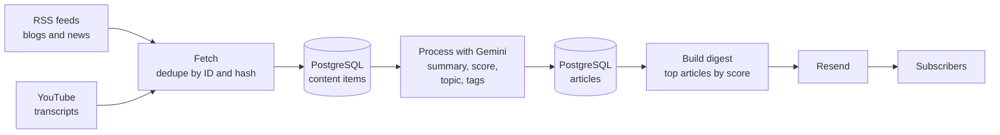

# AI News Aggregator

> A daily AI news digest powered by three specialised agents: one collects posts and YouTube videos, one uses Gemini to summarise, score and tag each item, and one emails subscribers only the highest-quality stories.

      

<!-- Demo: add a screenshot of a digest email, e.g. docs/digest.png -->

## Why I built it

AI news moves fast and is spread across company blogs, news sites and YouTube. I wanted one short email each morning with only the updates worth reading, and a project that covers a full data pipeline: ingestion, LLM processing, storage, ranking and delivery.

## Features

- **Multi-source ingestion:** RSS feeds from AI company blogs and tech news sites, plus YouTube videos using their transcripts
- **No duplicates:** items are matched by source ID and content hash, so the same story isn't processed twice
- **LLM processing with Gemini 2.5 Flash:** each item gets a summary, a 0 to 10 quality score, a topic and tags
- **Quality filter:** only articles above a configurable minimum score make the digest, ranked by score
- **HTML email digest** sent to every active subscriber through Resend
- **Configurable:** sources, send time, summary length, minimum score and digest size are all set in `.env`

## How it works



The pipeline has three stages:

| Stage | What it does |
|---|---|
| Fetch | Pulls the last 24 hours of RSS and YouTube content and stores new items |
| Process | Sends each new item to Gemini for a summary, quality score, topic and tags |
| Deliver | Picks the highest-scoring articles and builds the HTML email |

`jobs/daily_digest.py` runs all three stages in order and sends the digest. Schedule it with cron to run every morning.

## Tech stack

| Area | Technologies |
|---|---|
| App | Python, Flask (app factory pattern) |
| LLM | Google Gemini 2.5 Flash |
| Data | PostgreSQL, SQLAlchemy, Alembic |
| Ingestion | feedparser, BeautifulSoup, youtube-transcript-api |
| Email | Resend |
| Infrastructure | Docker Compose (PostgreSQL), cron |

## Quick start

```bash
git clone https://github.com/Jai-Negi/ai-news-aggregator.git
cd ai-news-aggregator
cp .env.example .env            # add your Gemini and Resend keys
docker compose up -d            # starts PostgreSQL
python -m venv venv && source venv/bin/activate
pip install -r requirements.txt
python jobs/daily_digest.py     # fetch, process and send
```

Run it every day at 8 am:

```bash
0 8 * * * cd /path/to/ai-news-aggregator && venv/bin/python jobs/daily_digest.py >> logs/daily.log 2>&1
```

Manage subscribers with the scripts in `scripts/` (`list_subscribers.py`, `remove_subscriber.py`, `send_digest.py`).

## Configuration

| Variable | Purpose |
|---|---|
| `GEMINI_API_KEY` | Gemini API key |
| `RESEND_API_KEY`, `FROM_EMAIL` | Email delivery |
| `DATABASE_URL` | PostgreSQL connection |
| `RSS_FEEDS`, `YOUTUBE_CHANNELS` | Sources to collect from |
| `MIN_QUALITY_SCORE` | Lowest score allowed in the digest |
| `MAX_ITEMS_PER_DIGEST` | Number of stories per email |
| `DIGEST_SEND_HOUR`, `DIGEST_SEND_MINUTE` | Send time |

See `.env.example` for the full list. Everything runs on free tiers.

## Project structure

```
app/            Pipeline stages, service clients (Gemini, Resend, RSS, YouTube) and SQLAlchemy models
jobs/           Daily pipeline job
scripts/        Subscriber and digest utilities
config/         Settings loaded from .env
```

## What I learned

- Splitting the work into fetch, process and deliver agents made each part easier to debug and rerun on its own
- Asking the LLM for a numeric quality score turned out to be a simple, effective filter for noisy sources
- Storing raw items before processing means a failed LLM call never loses data, it just gets retried on the next run

## Next steps

- Add automated tests and CI
- A web page for subscribing and unsubscribing
- Personalised digests based on each subscriber's topics

## License

MIT
